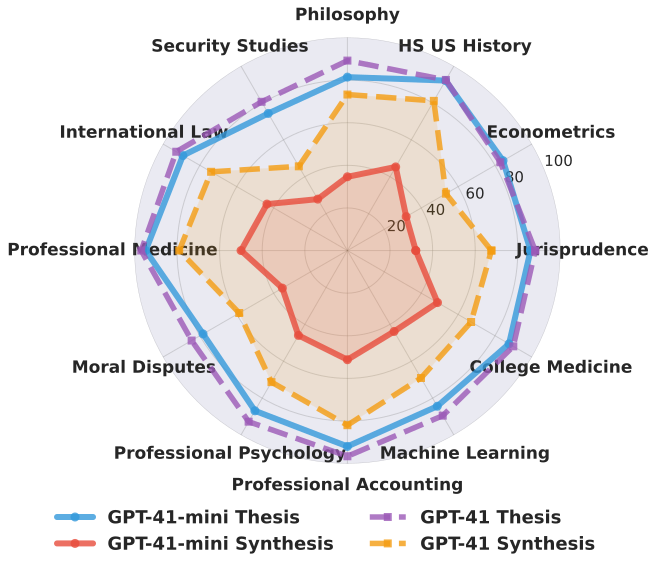

# Evaluating Reasoning of LLMs through Dialectical Methodology with SIEV

<div align="center">

[](https://python.org)
[](LICENSE)
[](README.md)

*A structured framework for evaluating reasoning capability of Large Language Models through dialectical methodology, revealing hidden gaps even in saturated benchmarks*

</div>

## 🎯 Overview

SIEV (Structured dIalectical rEasoning eValuation) is a benchmark-agnostic framework for evaluating LLM reasoning that goes beyond traditional correctness-based assessments. Drawing from Hegelian dialectics, SIEV evaluates not only the conclusion a model reaches, but how it gets there: its ability to resolve tension, integrate distinct ideas, and synthesize higher-order reasoning through **Thesis-Antithesis-Synthesis**.

**Framework Design**: SIEV is designed as a general-purpose evaluation methodology that can be adapted to any reasoning benchmark. The current implementation provides comprehensive examples and templates for GSM-8K and MMLU benchmarks, demonstrating how to apply dialectical evaluation to mathematical reasoning and multi-domain knowledge assessment.

### 🔍 Why Process-Oriented Evaluation?

Most current evaluations reward models' correct standalone answers—but correctness alone reveals little about the reasoning process that produced them. SIEV addresses this gap by assessing reasoning as a dynamic trajectory where ideas interact, clash, and evolve into deeper insights. This approach uncovers significant reasoning gaps in state-of-the-art models even under saturated benchmarks like GSM and MMLU, where conventional evaluations suggest near-perfect performance.

### 🏗️ Framework Architecture

SIEV's benchmark-agnostic design enables evaluation of any reasoning task through:

- **Customizable Templates**: Adapt dialectical prompts to your domain's reasoning patterns
- **Flexible Role Definitions**: Configure thesis, antithesis, and synthesis roles for your use case  
- **Modular Pipeline**: Easy integration with existing evaluation workflows

### 📊 Quick Sample: Visual Comparison of Reasoning Performance

The radar charts below demonstrate SIEV's ability to reveal hidden reasoning differences between seemingly comparable models across MMLU subject areas:

<div align="center">

| GPT-4.1-mini vs GPT-4.1 | GPT-5-chat vs DeepSeek-V3 | Llama-3.3-70B vs DeepSeek-R1 |
|:---:|:---:|:---:|
|  |  |  |

</div>

> **📝 Note:** "Thesis" scores represent traditional evaluation while "Synthesis" scores show our dialectical assessment. SIEV's process-driven method reveals significant reasoning gaps between models that standard outcome-oriented evaluations fail to detect.

### 📊 More Evaluation Results

The table below presents dialectical evaluation results across 21 state-of-the-art LLMs on GSM-8K and MMLU benchmarks, revealing significant reasoning gaps even in models with near-perfect traditional performance:

<details>

<summary><strong>📈 Click to view evaluation results table</strong></summary>

**Key Metrics:**

- **p_T**: Conventional evaluation method (Thesis Accuracy)
- **p_S**: Synthesis accuracy  
- **Δ**: p_S - p_T (synthesis improvement over thesis)
- **OC**: Opposition Compliance (fraction where antithesis opposes thesis)
- **DS**: New Dialectical Reasoning Score = p_S × (λ + (1-λ) × OC^γ) with λ=0.7, γ=1.0

**Notes:**

- Numbers are in percentage points
- Rankings use dense ranking (1, 1, 2, 3)
- Ranking ties assigned when absolute score differences ≤ 0.5
- **Bold**: Top 3 ranks for DS metric

#### GSM-8K Results

<div style="font-size: 0.95em; line-height: 1.1;">

| Model | p_T (Rank) | p_S (Rank) | Δ | OC | DS (Rank) |
|-------|------------|------------|---|----|-----------| 
| **O3** | 97.1±0.1 (1) | 93.6±0.7 (1) | -3.5 | 95.5 | **92.3 (1)** |
| **GPT-4** | 95.1±0.2 (4) | 88.3±0.5 (3) | -6.8 | 83.1 | **84.3 (2)** |
| **O1** | 96.5±0.2 (2) | 82.7±1.0 (5) | -13.8 | 97.0 | **82.0 (3)** |
| **Kimi-K2** | 96.8±0.2 (1) | 81.6±1.1 (6) | -15.2 | 92.5 | 79.7 (4) |
| **GPT-5** | 96.8±0.2 (1) | 82.0±0.8 (6) | -14.7 | 81.4 | 77.5 (5) |
| **Llama-3.3-70B-Inst** | 96.2±0.4 (2) | 89.5±0.1 (3) | -6.7 | 51.9 | 76.6 (6) |
| **DeepSeek-R1** | 96.1±0.2 (2) | 79.2±1.0 (8) | -16.8 | 75.8 | 73.5 (6) |
| **GPT-5-mini** | 96.9±0.1 (1) | 80.1±0.5 (7) | -16.8 | 71.4 | 73.3 (6) |
| **O3-mini** | 96.1±0.3 (2) | 91.6±0.3 (2) | -4.5 | 29.4 | 72.2 (7) |
| **GPT-4o** | 95.9±0.3 (3) | 84.2±0.3 (4) | -11.7 | 48.4 | 71.2 (8) |
| **DeepSeek-V3** | 96.3±0.2 (2) | 75.3±0.3 (9) | -21.0 | 69.8 | 68.4 (9) |
| **O4-mini** | 96.5±0.2 (2) | 69.4±0.6 (11) | -27.1 | 94.9 | 68.4 (9) |
| **GPT-4.1** | 95.1±0.4 (4) | 70.3±0.2 (10) | -24.8 | 90.1 | 68.2 (9) |
| **Phi-4** | 94.2±0.3 (5) | 84.5±0.8 (4) | -9.7 | 35.2 | 68.1 (9) |
| **GPT-4.1-mini** | 95.5±0.0 (3) | 70.4±1.1 (10) | -25.1 | 77.8 | 65.7 (10) |
| **GPT-5-nano** | 94.8±0.4 (4) | 84.4±0.8 (4) | -10.4 | 15.5 | 63.0 (11) |
| **O1-mini** | 93.3±0.4 (6) | 59.6±1.1 (13) | -33.7 | 78.7 | 55.8 (12) |
| **Qwen2.5-72B-Inst** | 95.7±0.2 (3) | 63.8±0.3 (12) | -31.9 | 56.7 | 55.5 (12) |
| **GPT-5-chat** | 96.4±0.1 (2) | 56.2±1.0 (14) | -40.2 | 85.2 | 53.7 (13) |
| **Ministral-8B-Inst-2410** | 86.1±0.9 (7) | 55.9±0.3 (14) | -30.2 | 63.8 | 49.8 (14) |
| **GPT-3.5** | 76.4±0.6 (7) | 40.2±0.6 (15) | -36.2 | 50.0 | 34.5 (15) |

</div>

#### MMLU Results

<div style="font-size: 0.95em; line-height: 1.1;">

| Model | p_T (Rank) | p_S (Rank) | Δ | OC | DS (Rank) |
|-------|------------|------------|---|----|-----------| 
| **O1** | 91.1±0.0 (2) | 90.3±0.1 (1) | -0.7 | 96.0 | **89.2 (1)** |
| **O3** | 92.2±0.1 (1) | 90.3±0.2 (1) | -1.9 | 92.7 | **88.4 (2)** |
| **GPT-5** | 92.2±0.1 (1) | 86.7±0.1 (2) | -5.5 | 92.5 | **84.8 (3)** |
| **Kimi-K2** | 88.6±0.1 (5) | 80.7±0.2 (4) | -7.9 | 94.0 | 79.3 (4) |
| **O4-mini** | 88.6±0.1 (5) | 77.7±0.2 (6) | -10.9 | 93.4 | 76.1 (5) |
| **GPT-5-mini** | 89.3±0.1 (4) | 79.0±0.3 (5) | -10.3 | 84.3 | 75.3 (6) |
| **GPT-4** | 86.0±1.3 (7) | 75.8±1.3 (7) | -10.2 | 93.7 | 74.4 (7) |
| **O3-mini** | 85.0±0.1 (8) | 83.8±0.1 (3) | -1.3 | 55.0 | 72.4 (8) |
| **GPT-4.1** | 88.7±0.0 (5) | 73.2±0.2 (9) | -15.6 | 95.3 | 72.1 (8) |
| **DeepSeek-R1** | 90.1±0.1 (3) | 77.3±0.4 (6) | -12.8 | 75.1 | 71.5 (9) |
| **DeepSeek-V3** | 86.6±0.2 (6) | 73.8±0.2 (8) | -12.8 | 86.7 | 70.8 (10) |
| **Phi-4** | 82.0±0.1 (9) | 73.5±0.2 (8) | -8.5 | 81.1 | 69.3 (11) |
| **O1-mini** | 81.8±0.2 (9) | 69.9±0.1 (10) | -11.9 | 89.0 | 67.6 (12) |
| **GPT-4o** | 86.5±0.1 (6) | 68.6±0.2 (11) | -17.9 | 93.7 | 67.3 (12) |
| **Qwen2.5-72B-Inst** | 84.4±0.1 (8) | 64.8±0.2 (12) | -19.7 | 64.7 | 57.9 (13) |
| **Llama-3.3-70B-Inst** | 85.1±0.1 (6) | 58.3±0.1 (14) | -26.8 | 80.7 | 54.9 (14) |
| **GPT-4.1-mini** | 84.9±0.1 (8) | 54.7±0.2 (13) | -30.2 | 91.0 | 53.2 (15) |
| **GPT-5-nano** | 85.8±0.2 (7) | 62.4±0.1 (13) | -23.4 | 43.3 | 51.8 (16) |
| **GPT-5-chat** | 88.2±1.7 (5) | 50.5±0.9 (15) | -37.7 | 95.1 | 49.8 (17) |
| **Ministral-8B-Inst-2410** | 62.3±0.2 (11) | 41.3±0.3 (16) | -20.9 | 59.3 | 36.3 (18) |
| **GPT-3.5** | 67.7±0.8 (10) | 35.2±0.3 (17) | -32.4 | 65.4 | 31.6 (19) |

</div>

</details>

> **📄 For detailed statistical analysis, experimental methodology, and philosophical foundations, see our paper: [*Measuring Reasoning in LLMs: a New Dialectical Angle*](https://arxiv.org/abs/placeholder)**

## 🏗️ Simplified Architecture

SIEV uses a **two-tier API architecture** with model routing:

| API File | Purpose | Model Examples |
|----------|---------|----------------|
| `general_api.py` | Standard Models | `gpt-4o`, `gpt-4.1`, `llama-3.1-70b` |
| `reasoning_api.py` | Reasoning Models | `o1`, `o3`, `gpt-5` |

## ✨ Key Features

- **🧠 Process-Oriented Assessment**: Evaluates not just what models conclude, but how they reason - their ability to navigate tension, contradiction, and synthesis
- **📊 Benchmark-Agnostic Framework**: Can be applied to existing datasets without modification, transforming saturated benchmarks into powerful reasoning diagnostics  
- **🔍 Hidden Gap Detection**: Reveals significant reasoning limitations even in state-of-the-art models that achieve near-perfect scores on traditional evaluations
- **🛡️ Contamination Resistant**: Emphasizes dynamic reasoning over static recall, reducing vulnerability to benchmark leakage from training data
- **🤝 Multi-Agent Ready**: Natural fit for collaborative reasoning evaluation as LLM systems become increasingly distributed
- **📈 Discriminative Analysis**: Exposes nuanced differences among top-performing models that conventional evaluations fail to detect
- **� Comprehensive Logging System**: Real-time progress tracking with experiment identification, structured logging, performance metrics, and parallel execution support

## 🚀 Quick Start

### Installation & Setup

```bash
# Clone the repository
git clone https://github.com/microsoft/siev.git
cd siev

# Setup environment and dependencies
chmod +x setup.sh
./setup.sh

# Activate virtual environment
source ../SIEVenv/bin/activate

# Validate installation
./validate.sh
```

### Configuration

If validation shows environment configuration needed:

```bash
# Copy template and configure your API settings
cp .env.example env/.env
# Edit env/.env with your API credentials and endpoints

# Re-validate to confirm configuration
./validate.sh
```

## 📊 Dataset Preparation

### Samples: MMLU, GSM8k

SIEV is benchmark-agnostic and works with any dataset. For demonstration purposes, we provide conversion tools for popular benchmarks:

**Example Datasets**: [GSM-8K](https://github.com/openai/grade-school-math/raw/master/grade_school_math/data/test.jsonl) | [MMLU](https://people.eecs.berkeley.edu/~hendrycks/data.tar)

*Note: Extract the MMLU tar file after download: `tar -xf data.tar`*

### Convert to SIEV Format (Examples)

*SIEV can work with any dataset in the proper JSON format. The examples below show how to convert popular benchmarks:*

#### GSM Dataset Conversion

```bash
python3 scripts/dataset_conversion/convert_gsm.py \
    --input_file test.jsonl \
    --output_dir data/input/gsm_data
```

#### MMLU Dataset Conversion

**Note**: Activate virtual environment first to ensure pandas and other dependencies are available:
```bash
source ../SIEVenv/bin/activate  # Activate virtual environment
```

```bash
# Convert all subjects
python3 scripts/dataset_conversion/convert_mmlu.py \
    --input_dir data/test \
    --output_dir data/input/mmlu_dataset

# Convert specific subjects only
python3 scripts/dataset_conversion/convert_mmlu.py \
    --input_dir data/test \
    --output_dir data/input/mmlu_dataset \
    --subjects "abstract_algebra,anatomy,astronomy"

# List available subjects
python3 scripts/dataset_conversion/convert_mmlu.py \
    --input_dir data/test \
    --list_subjects
```

**📖 Detailed Documentation**: See `scripts/dataset_conversion/README.md` for comprehensive conversion instructions, troubleshooting, and advanced options.

## 🔧 Adapting SIEV to Other Benchmarks

SIEV's benchmark-agnostic design makes it easy to evaluate reasoning on any domain. To adapt SIEV to your benchmark:

### 1. Template Customization

Modify dialectical prompts in `prompts/templates/` to match your domain:

### 2. Role File Configuration  

Update role definitions in `prompts/roles/` to match your evaluation context:

### 3. Output Format Adaptation

**Critical**: Modify the answer extraction logic in your evaluation scripts to match your benchmark's expected format:

- **JSON Structure**: Adapt question-answer formatting in your dataset conversion
- **Answer Pattern**: Update regex patterns in evaluation scripts to catch your answer format
- **Validation Logic**: Modify correctness checking to match your domain's evaluation criteria

### 4. Integration Steps

1. **Create your dataset converter** (use `scripts/dataset_conversion/` as reference)
2. **Update evaluation scripts** to use your templates and roles  
3. **Test with small sample** to verify dialectical flow works for your domain
4. **Validate output format** matches your analysis requirements

**Example Integration:**
```bash
# Your custom evaluation script
./evaluate-yourdomain.sh "gpt-4o" "custom-experiment" "env/.env" 3 "data/input/yourdomain/sample.json"
```

### Ready to Evaluate! 🎯

Once validation passes, you can run evaluations:

#### Quick Start: Using Provided Sample Exams

**Without downloading MMLU/GSM datasets**, you can start immediately using the provided sample exams:

```bash
# MMLU Sample Evaluation
./evaluate-mmlu.sh "gpt-4o" "mmlu-sample-exp" "env/.env" 3 "data/input/mmlu_dataset/sample_exam.json"

# GSM Sample Evaluation  
./evaluate-gsm.sh "gpt-4o" "gsm-sample-exp" "env/.env" 3 "data/input/gsm_data/sample_exam.json"
```

#### Full Dataset Evaluation

After downloading and converting GSM/MMLU datasets using the conversion scripts (see Dataset Conversion section above), you can run comprehensive evaluations:

#### GSM-8K Evaluation

```bash
./evaluate-gsm.sh "gpt-4o" "gsm-experiment" "env/.env" 3 "data/input/gsm_data/gsm_exam.json"
```

#### MMLU Evaluation  

```bash
./evaluate-mmlu.sh "gpt-4o" "mmlu-experiment" "env/.env" 3 "data/input/mmlu_dataset/abstract_algebra_test_mmlu_exam.json"
```

The console output includes clear experiment and attempt identification for tracking parallel evaluations. All detailed logs are automatically saved to structured files. See **[Logging System Documentation](docs/LOGGING.md)** for complete details.

### View Results

Results are automatically generated in your experiment directory:

```bash
# View evaluation outputs
ls data/experiments/your-experiment-name/
# Contains: all_responses.json, evaluation_results_attempt_1.json, summary_aggregate.json, final_results_table.csv

# View the standardized final results table
cat data/experiments/your-experiment-name/final_results_table.csv
```

**Final Results Table Structure:**

| Model | Scenario | p_T | p_S | Δ | OC | DS |
|-------|----------|-----|-----|---|----|----|
| GPT-4o | gsm | 0.750 | 0.820 | 0.070 | 0.450 | 0.689 |
| GPT-4o | mmlu | 0.680 | 0.710 | 0.030 | 0.380 | 0.605 |

## 🔧 Configuration

### Environment Variables

```bash
# General API (for most models)
GENERAL_API_KEY=your_general_api_key
GENERAL_API_ENDPOINT=https://api.example.com/v1

# Reasoning API (for O1, O3, specific GPT-5)
REASONING_API_KEY=your_reasoning_api_key
REASONING_API_ENDPOINT=https://reasoning-api.example.com/v1
```

### Model Selection

The framework automatically routes models to appropriate API handlers:

- **General Models**: Default route for all models except reasoning variants
- **Reasoning Models**: Automatic detection for O1, O3, and specific GPT-5 variants

Model routing examples:

- `gpt-4o` → General API
- `o1` → Reasoning API (advanced reasoning)
- `gpt-5-2025-08-07` → Reasoning API (reasoning variant)

## 📊 Results & Analysis

### Automatic Output Generation

Every evaluation run automatically generates:

- **`all_responses.json`** - Complete dialectical conversations (thesis, antithesis, synthesis)
- **`evaluation_results_attempt_N.json`** - Statistical metrics and accuracy scores
- **`summary_aggregate.json`** - Cross-dataset aggregated results
- **`final_results_table.csv`** - Standardized final metrics table with key performance indicators

### Final Results Table - Key Innovation

The **`final_results_table.csv`** provides a standardized summary of dialectical performance with five core metrics:

| Metric | Description | Formula |
|--------|-------------|---------|
| **p_T** | Thesis Accuracy | Ratio of correct thesis |
| **p_S** | Synthesis Accuracy | Ratio of correct synthesis |
| **Δ** | Delta | p_S - p_T (dialectical improvement) |
| **OC** | Opposition Compliance | Fraction where antithesis opposes thesis |
| **DS** | Dialectical Score | p_S × (λ + (1-λ) × OC^γ) |

**Example Output:**

```csv
Model,Scenario,p_T,p_S,Δ,OC,DS
GPT-4o,gsm,0.750,0.820,0.070,0.450,0.689
GPT-4o,mmlu,0.680,0.710,0.030,0.380,0.605
```

## 📁 Project Structure

```text
siev/
├── src/                          # Core source code
│   ├── dialectical_evaluator.py # Main evaluation engine
│   ├── general_api.py           # General models API handler
│   ├── reasoning_api.py         # Reasoning models API handler
│   └── siev_logging/           # Comprehensive logging system
│       ├── logger.py           # Core logging functionality
│       ├── progress.py         # Progress tracking and ETA
│       └── formatters.py       # Console and file formatters
├── scripts/                     # Analysis and utility scripts
│   ├── analysis/                # Analysis tools
│   │   ├── generate_final_table.py         # Final results table generator
│   │   ├── aggregate_experiments.py        # Cross-experiment aggregation
│   │   ├── generate_summary.py            # Summary statistics generation
│   │   └── evaluate_reasoning.py          # Dialectical reasoning evaluation
│   ├── core/                   # Core evaluation functions
│   └── experiments/            # Experiment orchestration scripts
├── prompts/                     # Prompt templates
│   ├── templates/              # Dialectical prompt templates
│   └── roles/                  # Role definitions
├── data/                        # Data directories
│   ├── input/                  # Input datasets
│   └── experiments/            # Experiment results
├── docs/                        # Documentation
│   ├── API_SETUP.md            # API configuration guide
│   └── LOGGING.md               # Logging system documentation
├── evaluate-gsm.sh              # GSM evaluation script
├── evaluate-mmlu.sh             # MMLU evaluation script
└── requirements.txt             # Python dependencies
```

### Research Impact

SIEV's dialectical approach has revealed fundamental insights about LLM reasoning:

- **Beyond Surface Accuracy**: Traditional evaluations significantly overestimate reasoning capabilities by focusing solely on correctness
- **Process Matters**: Reasoning quality depends on how models handle tension, contradiction, and integration—not just final outcomes  
- **Hidden Weaknesses**: Even top-performing models show substantial reasoning degradation under dialectical assessment
- **Benchmark Saturation Myth**: "Saturated" benchmarks like GSM and MMLU still reveal major reasoning gaps when evaluated through SIEV

## 📚 Documentation

- **[API Setup Guide](docs/API_SETUP.md)**: Detailed endpoint configuration
- **[Logging System](docs/LOGGING.md)**: Comprehensive logging, progress tracking, and error handling
- **[Output Structure](docs/OUTPUT_STRUCTURE.md)**: Understanding results and metrics

## 🤝 Contributing & Support

### Contributing

We welcome contributions from the community! See [CONTRIBUTING.md](CONTRIBUTING.md) for guidelines.

### Issues & Bug Reports

- Use GitHub Issues for bug reports and feature requests
- Include system information and error logs

### Contact & Support

- **Issues**: [GitHub Issues](https://github.com/microsoft/siev/issues)
- **Discussions**: [GitHub Discussions](https://github.com/microsoft/siev/discussions)  
- **Email**: [soheil.abbasloo@microsoft.com](mailto:soheil.abbasloo@microsoft.com)

## 📄 License

This project is licensed under the MIT License - see the [LICENSE.TXT](LICENSE.TXT) file for details.

## 📖 Citation

If you use SIEV in your research, please cite:

```bibtex
TO BE SET 
```
<!-- ```bibtex
@article{siev2025,
  title={Measuring Reasoning in LLMs: a New Dialectical Angle},
  author={Soheil Abbasloo},
  journal={arxiv preprint},
  year={2025}
}
``` -->

## 👥 Contributors

**Lead Author & Maintainer:**

- **Soheil Abbasloo** - [soheil.abbasloo@microsoft.com](mailto:soheil.abbasloo@microsoft.com)

## 🤝 Code of Conduct

This project has adopted the [Microsoft Open Source Code of Conduct](https://opensource.microsoft.com/codeofconduct/). For more information see the [Code of Conduct FAQ](https://opensource.microsoft.com/codeofconduct/faq/) or contact [opencode@microsoft.com](mailto:opencode@microsoft.com) with any additional questions or comments.

## ™️ Trademarks

This project may contain trademarks or logos for projects, products, or services. Authorized use of Microsoft trademarks or logos is subject to and must follow [Microsoft's Trademark & Brand Guidelines](https://www.microsoft.com/en-us/legal/intellectualproperty/trademarks/usage/general). Use of Microsoft trademarks or logos in modified versions of this project must not cause confusion or imply Microsoft sponsorship. Any use of third-party trademarks or logos are subject to those third-party's policies.

## 🔒 Security

Security issues and bugs should be reported privately via email to the Microsoft Security Response Center (MSRC) at [secure@microsoft.com](mailto:secure@microsoft.com). You should receive a response within 24 hours. If for some reason you do not, please follow up via email to ensure we received your original message.

---

Revealing True Reasoning Through Structured Dialectical Evaluation
